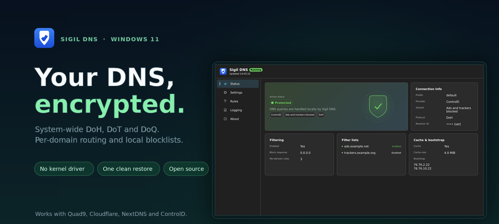

<p align="center"></p>

<h1 align="center">Sigil DNS</h1>

<p align="center"><a href="https://github.com/daika7ana/sigil-dns/actions/workflows/ci.yml"></a> <a href="https://github.com/daika7ana/sigil-dns/releases/latest"></a> <a href="LICENSE"></a>  <a href="go.mod"></a></p>

<p align="center"><strong>System-wide encrypted DNS for Windows 11 — no kernel driver, no per-adapter fiddling.</strong></p>

<p align="center"></p>

Sigil DNS quietly points Windows at a DNS resolver you trust. It runs a small
loopback DNS server on `127.0.0.1:53` and `[::1]:53`, then installs a catch-all
NRPT rule, with more-specific no-nameserver exemptions for per-domain bypass
rules. Your apps keep using the normal OS resolver — their queries just travel
encrypted (DoH / DoH3 / DoT / DoQ) to the provider you picked, with per-domain routing
and local blocklists along the way.

Turning it on is **one catch-all rule in**. Turning it off is **one clean restore
out**. No driver, no network re-plumbing, no leftover state.

Prefer buttons to flags? The shipped **GUI** gives you a five-page configuration
client (Status, Settings, Rules, Logging, About) for the same engine. Prefer the
terminal? Every command is there too.

> **New here?** Jump straight to [Install](#install) and [Quickstart](#quickstart).

---

## What it does

- **Encrypts your DNS system-wide.** A catch-all NRPT rule covers all namespaces
  (per-domain bypass rules add more-specific no-nameserver exemptions), so
  normal apps get encrypted lookups without any per-app or per-adapter setup.
- **Lets you choose the resolver.** Quad9, Cloudflare, NextDNS, ControlD, or any
  custom DoH / DoT / DoQ URL.
- **Routes by domain.** dnsmasq-style rules — send `corp.example` to an internal
  resolver while everything else goes to your provider.
- **Blocks locally.** hosts-format and AdGuard/ABP lists via
  `AdguardTeam/urlfilter`; blocked answers are `0.0.0.0` / `::` or NXDOMAIN.
- **Stays out of your way.** Enable applies it, Disable removes it, Restore
  recovers after a crash. A registry watcher and a 45 s reconcile loop put
  interception back if Windows, GPO, or another tool rewrites it.

The design goal is the *outcome*: one catch-all rule in, one restore out, no
per-adapter churn, no driver. See [SPEC.md](SPEC.md) for the full design.

## Features

- **Providers** — Quad9, Cloudflare, NextDNS, ControlD, or any custom
  DoH/DoH3/DoT/DoQ URL.
- **Encrypted upstreams** — DoH, DoH3 (HTTP/3, `h3://host/dns-query`), DoT, and
  DoQ (`quic://host:853`).
- **Per-domain routing** — dnsmasq-style rules, applied before the upstream:
  route a domain to an upstream, or bypass it to the system's normal DNS.
- **Blocklists** — hosts-format and AdGuard/ABP lists, with `0.0.0.0`/`::` or
  NXDOMAIN block responses.
- **Clean enable / disable / restore** — NRPT is added on enable and removed on
  disable; `restore` recovers after a crash.
- **Drift auto-reconcile** — a registry watcher plus a 45 s reconcile loop
  re-apply interception if Windows, GPO, or another tool rewrites it.
- **Crash recovery** — a dirty marker forces a restore on the next start, so a
  killed service can never leave the machine pointing at a dead resolver.
- **Service + CLI** — one console binary runs as the CLI or the Windows service.
- **GUI config client** — a five-page window (Status, Settings, Rules, Logging,
  About): Start / Stop and Restore, service install / remove, and profile /
  rules / filtering / cache editing. The shipped binaries request admin via an
  embedded manifest, so Windows prompts UAC once at **launch** and the process
  runs elevated until you close it.

## Requirements

- **Windows 11 x64.**
- **Administrator rights** to install the service and to enable/disable
  interception (both touch NRPT and the SCM). The binaries ask for elevation on
  every launch, so this is normally automatic.

---

## Install

> **Releases are not code-signed yet.** Windows will show **"Windows protected
> your PC"** ("Unknown publisher") the first time you run a downloaded
> `sigildns.exe` or `sigildns-gui.exe`. That is SmartScreen having no
> reputation for the file, not a broken download. Check the archive against
> `SHA256SUMS.txt` on the release page, then pick **More info → Run anyway**.
> The hash proves the download is intact, not who built it — only a signature
> can do that. On a managed machine the policy may forbid the override; ask IT
> to allow the file hash.
>
> ```powershell
> Get-FileHash .\sigildns_<version>_windows_amd64.zip -Algorithm SHA256
> ```

### Option A — one-line install (recommended)

From a normal (non-elevated) PowerShell window:

```powershell
irm https://raw.githubusercontent.com/daika7ana/sigil-dns/main/install.ps1 | iex
```

It downloads the latest release, verifies the zip against the release's
`SHA256SUMS.txt`, then shows the Install / Uninstall menu in the elevated window
(**one UAC prompt**). After installing it offers to add the install folder to the
system PATH (so `sigildns` works in any new terminal) and to open the GUI.
Running it again upgrades an existing install.

Piping a remote script into `iex` runs it sight unseen. To inspect it first:

```powershell
irm https://raw.githubusercontent.com/daika7ana/sigil-dns/main/install.ps1 -OutFile install.ps1
notepad install.ps1
.\install.ps1
```

If PowerShell refuses to run the saved file ("not digitally signed"), unblock it
first: `Unblock-File .\install.ps1`.

Uninstall (keeps `%ProgramData%\SigilDNS`; add `-RemoveData` to delete it too):

```powershell
& ([scriptblock]::Create((irm https://raw.githubusercontent.com/daika7ana/sigil-dns/main/install.ps1))) -Uninstall
```

The saved script takes the same switches: `.\install.ps1 -Uninstall -RemoveData`,
or `.\install.ps1 -Install -DesktopShortcut`. For unattended installs add
`-Quiet` (no menu, no prompts); the PATH and GUI changes are then opt-in with
`-AddToPath` and `-OpenGui`.

### Option B — packaged installer

**Double-click `install.ps1`** in the extracted folder — if Windows opens it in
an editor instead, right-click it and pick **Run with PowerShell**. Started
without elevation, the script relaunches itself through UAC, so you do not need
to open an Administrator prompt by hand. It then asks:

```
Sigil DNS setup
  1. Install or upgrade
  2. Uninstall
  3. Exit
Choose 1, 2 or 3:
```

This is the same script as the one-liner above; with the binaries next to it, it
installs those local files instead of downloading anything.

From an **elevated PowerShell** the same menu appears:

```powershell
.\install.ps1
```

Non-interactive use (skips the menu; `-Quiet` also skips the PATH/GUI prompts):

```powershell
.\install.ps1 -Install [-DesktopShortcut] [-AddToPath] [-OpenGui]
.\install.ps1 -Uninstall [-RemoveData]
.\install.ps1 -Quiet -Install [-AddToPath] [-OpenGui]
```

If PowerShell refuses to run the script ("not digitally signed"), unblock the
extracted files first: `Get-ChildItem -Recurse | Unblock-File`.

The installer registers the Windows service and drops a **Start Menu shortcut**
named Sigil DNS that launches the GUI. After installing it offers to add the
install folder to the system PATH and to open the GUI. Just run it from the Start
Menu whenever you want to change something. Uninstall keeps
`%ProgramData%\SigilDNS` (config and state) and removes the PATH entry; pass
`-RemoveData` to delete the data too.

### Option C — manual

From an **elevated PowerShell**, after building or downloading the binary:

```powershell
sigildns config init            # writes a default config if none exists
sigildns service install        # register the service (runs as LocalSystem)
sigildns service start
```

`service install` registers the service to start automatically and points it at
the current executable with the `--service` argument. Uninstall with
`sigildns service uninstall` (which stops the service first and restores
interception).

> The service runs as **LocalSystem**. The least-privilege virtual account
> cannot create the IPC pipe instances, is locked out of its own state file, and
> lacks the rights NRPT writes need. See SPEC §2.

---

## Quickstart

### With the GUI

1. Launch **Sigil DNS** from the Start Menu (or run `sigildns-gui.exe` with no
   arguments).
2. On **Settings**, pick a provider / variant / protocol in the profile editor
   and hit **Save**.
3. On **Settings**, press **Start** in the service card.

The state hero turns green (**Protected**) once the resolver is up and
interception is applied. Everything the GUI does is available on the CLI too.

### With the CLI

```powershell
# 1. Create a config (never clobbers an existing file)
sigildns config init

# 2. Pick a provider and print its generated upstream block
sigildns providers list
sigildns providers show quad9/secure/doh
sigildns providers show nextdns/ultralow/doh --id          # prompts, input hidden
sigildns providers show nextdns/ultralow/doh --id-file <path>
sigildns providers show controld/p1/doh

#    Resolver ids are secret: use --id (prompt) or --id-file <path> (or - for
#    stdin); a value on the command line is refused.

#    Paste the printed upstreams/bootstrap into your config.
#    (The default config points at ControlD free p0.)

# 3. Install and start the service (elevated)
sigildns service install
sigildns service start

# 4. Verify (the binary always requests admin, so this elevates too)
sigildns status
```

Starting the service always enables interception (bind → two-stage health check
→ state + dirty marker → NRPT → flush); the SCM state stays Starting until that finishes, and
a running service is never left with protection off. If enabling fails the
service stops; a bad config exits cleanly so fix it and start again, while other
failures are retried by the SCM recovery actions. Read status as JSON to confirm
`"mode": "on"`.

Want to try the resolver **without touching the system**? Run it in the
foreground:

```powershell
sigildns run --upstream https://dns.quad9.net/dns-query
```

---

## GUI

`sigildns-gui.exe` is the full configuration client, in five pages:

- **Status** — a state hero, Connection Info, Filtering, Filter lists, and
  Cache & bootstrap cards, plus **Restore now** for a crash-leftover state.
- **Settings** — a Start / Stop control plus service install / remove and state,
  an **Appearance** card with the Auto / Light / Dark picker, a profile list
  with add / rename / delete / set-active, a per-profile editor
  (provider / variant / protocol, a masked resolver id, custom URL, bootstrap,
  fallback profile, cache and size), and
  **Window & tray**.
- **Rules** — the filtering toggle and block response, filter lists, and
  per-domain routing rules (Upstream or Bypass).
- **Logging** — level, location, and a live log viewer.
- **About** — client / service / interface versions, author, repository, license,
  and an update check whose download is verified against the release's
  `SHA256SUMS.txt` before it is saved.

Start runs the service and applies interception; Stop removes it. The binaries
request admin via an embedded manifest, so Windows shows **one UAC prompt when
you launch either one** and the process runs elevated until you close it — this
applies to every `sigildns.exe` invocation, not just the GUI. A `gui.lock` next
to `gui.json` keeps a single instance. Launch it from the Start Menu shortcut, or
run `sigildns-gui.exe` with no arguments (`--gui` opens it explicitly). See
[docs/GUI.md](docs/GUI.md).

The **system tray icon is opt-in and off by default**. Enable it in Settings →
**Window & tray**, where you can also make closing or minimizing the window quit
it to the tray. The icon runs in a **separate small host process** with no
window, so keeping it in the notification area costs about 25-30 MB instead of
the ~230 MB an idle OpenGL window process uses. The GUI itself exits when you
close or minimize it to the tray; clicking the icon relaunches it, or brings it
to front if it is already open. Right-click offers a disabled live service
status row, Open, Open log file, Clear DNS cache (the resolver and Windows
caches, so a new rule is not hidden by an old answer), and Exit. While the tray
is on, **Start tray icon on startup** registers a per-user Task Scheduler
`ONLOGON` task (`SigilDNS`, current user, highest privileges) that launches the
GUI exe with `--tray` at sign-in. Because the task runs with highest privileges,
the tray host starts **elevated with no UAC prompt** — a documented user
decision that extends the SPEC §15.3.8 exception. The task is explicit, pins the
exe path it was enabled from (enable it from the installed copy), and is removed
when the tray is disabled and by uninstall. The `--tray` command starts that
host in a `-tags gui` build; a `-tags tray` build remains a stub.

---

## Providers

Run `sigildns providers list` for the live catalog.

| Provider | Variants | Notes |
|---|---|---|
| `quad9` | `secure` (default), `noblock`, `secure-ecs`, `noblock-ecs` | `*-ecs` variants send EDNS Client Subnet and leak a network prefix. |
| `cloudflare` | `standard` (default), `security`, `family` | 1.1.1.1 / 1.1.1.2 (malware) / 1.1.1.3 (malware + adult). No id. |
| `nextdns` | `ultralow` (default), `anycast` | Requires an id (`--id` prompt or `--id-file`). `ultralow` uses no bootstrap (best routing); `anycast` pins anycast IPs. |
| `controld` | `custom` (default), `p0`–`p3`, `x-oisd`, `x-stevenblack`, `x-adguard`, `family`, `uncensored`, `x-hagezi`, `free` | `custom`, `x-hagezi`, and `free` require an id (`--id` prompt or `--id-file`). Free presets share bootstrap IPs. |
| `custom` | `custom` | Raw user-entered `--upstream` URL + optional `--bootstrap`. |

Every preset offers **DoH, DoH3, DoT, and DoQ** (DoH3 is HTTP/3-only over
UDP/443, and needs the provider to serve HTTP/3), and every preset that uses a
bootstrap configures **both IPv4 and IPv6** addresses — including Cloudflare
`security` and `family`. The one exception is NextDNS `ultralow`, which
deliberately uses no bootstrap so it can pick the closest anycast node.

---

## Configuration

Configuration is a single YAML file:

| Platform | Config path |
|---|---|
| Windows | `%ProgramData%\SigilDNS\config.yaml` |
| Linux/dev | `$XDG_CONFIG_HOME/sigildns/config.yaml`, else `~/.config/sigildns/config.yaml` |

Precedence when starting: **command-line flags > config file > built-in
defaults**.

`config init` writes a minimal default: one profile named `default` using
ControlD free p0 with a 64 MiB cache. A fuller annotated example lives in
[config.example.yaml](config.example.yaml); see [docs/CONFIG.md](docs/CONFIG.md)
for every field, validation rule, the `block_response` values, and `per_domain`
semantics.

State is stored separately, owned by the service and ACLed to SYSTEM +
Administrators:

| Platform | State path |
|---|---|
| Windows | `%ProgramData%\SigilDNS\state.json` |
| Linux/dev | `$XDG_STATE_HOME/sigildns/state.json`, else `~/.local/state/sigildns/state.json` |

The GUI keeps its own window size, theme, and last-known summary in
`%LOCALAPPDATA%\SigilDNS\gui.json` (user scope; **never** secrets). Delete it
to reset the window to defaults. While the service is stopped, the Settings
editor shows the saved `config.yaml` so you can still review and edit it.

---

## Documentation

| Document | Contents |
|---|---|
| [docs/RELEASE.md](docs/RELEASE.md) | Release process, packaging, and signing |
| [docs/CONFIG.md](docs/CONFIG.md) | Every config field and validation rule |
| [docs/GUI.md](docs/GUI.md) | GUI pages, tray, and controls |
| [docs/LIMITATIONS.md](docs/LIMITATIONS.md) | Interception gaps and WSL/IPS caveats |
| [docs/TROUBLESHOOTING.md](docs/TROUBLESHOOTING.md) | Common failures and recovery |
| [SPEC.md](SPEC.md) | Authoritative design |
| [CHANGELOG.md](CHANGELOG.md) | Release history |
| [LICENSE](LICENSE) | GPLv3 |

---

## Known limitations

The table below is the honest interception surface. Anything that does not use
the OS resolver bypasses Sigil DNS entirely.

| Scenario | Intercepted? |
|---|---|
| Normal apps using the OS resolver | Yes |
| Apps with hardcoded resolver IPs or their own stub resolver | No |
| Browsers with built-in Secure DNS (DoH) | No — must be disabled in-browser |
| VPN that installs NRPT rules (e.g. `{.}`) | VPN rules may override or break ours; VPN DNS may hard-break |
| Captive portal (pre-auth) | Bootstrap DoH fails; the portal may be unreachable until we back off |
| `hosts` file / LLMNR / mDNS / NetBIOS local resolution | Bypasses DNS entirely |
| DNS-level blocklists | Only see OS-resolver traffic |

See [docs/LIMITATIONS.md](docs/LIMITATIONS.md) for the details, WSL notes, and
the IPS/port-53 caveat.

---

## CLI reference

```
sigildns <command> [flags]
```

| Command | Description |
|---|---|
| `enable` | Bind listeners, health-check, persist state, apply interception, then run until Ctrl-C. On exit, disable and restore. |
| `disable` | Stop the resolver, restore interception, clear the dirty marker. |
| `restore` | Restore interception from persisted state (crash recovery). Works even if the config file is corrupt. |
| `status [--summary]` | Print the persisted state as JSON, or `state: none (<path>)` if never enabled; `--summary` prints the sanitized config summary instead. |
| `reload` | Reload `config.yaml` through the running service (admin). |
| `refresh` | Re-download filter lists through the running service (admin). |
| `run` | Foreground resolver only, without touching interception (dev/CI). |
| `providers list` | List the provider preset catalog. |
| `providers show <provider>[/<variant>[/<protocol>]]` | Print the generated upstreams/bootstrap for a selection. |
| `config path` | Print the resolved config file path. |
| `config init` | Write a default config (never overwrites an existing file). |
| `service install` | Register the Windows service (start type automatic, LocalSystem). |
| `service uninstall` | Stop and remove the Windows service. |
| `service start` | Start the Windows service. |
| `service stop` | Stop the Windows service. |
| `--service` | Run the service host (invoked by the SCM, not by hand). |
| `--apply <path>` | Run the one-shot elevated helper (invoked by the GUI, not by hand). |
| `--gui` | Run the GUI. Requires a `-tags gui` build; the GUI binary also opens it with no arguments. |
| `--tray` | Run the native tray host with no window (`-tags gui` build; a `-tags tray` build remains a stub). |
| `help`, `-h`, `--help` | Print usage. |

### Flags

Flags are accepted by `enable`, `disable`, `restore`, `status`, `run`, and
`config` (both `-flag` and `--flag` forms work, per Go's `flag` package):

| Flag | Description | Default |
|---|---|---|
| `--upstream <url>` | Upstream DNS URL. Highest precedence. | ControlD free p0 |
| `--bootstrap <addr,...>` | Bootstrap resolver address(es), comma-separated. | `76.76.2.11:53` |
| `--config <path>` | Config file path. | platform default |
| `--profile <name>` | Config profile to use. | the config's active profile |
| `--listen <addr,...>` | Loopback listen addresses, comma-separated. | `127.0.0.1:53,[::1]:53` |
| `--state <path>` | State file path. | platform default |

> `providers show` uses its own parser and accepts `--id` (prompts with input
> hidden), `--id-file <path>` (or `-` for stdin), `--upstream`, and `--bootstrap`
> (before or after the positional selection). A resolver id is never a flag
> value. Protocol is one of `doh`, `dot`, `doq`; default `doh`.
>
> `enable`/`run --upstream` is the one documented argv exception (dev/CI); in
> production, resolver ids live only in `config.yaml`.

---

## Build from source

The repo ships a Docker wrapper so no host Go toolchain is needed:

```sh
./dev/go build ./...          # compile check (Linux)
./dev/go test ./...           # unit tests
GOOS=windows GOARCH=amd64 ./dev/go build -o sigildns.exe ./cmd/sigildns

# GUI binary (same module, GUI subsystem)
GOOS=windows GOARCH=amd64 CGO_ENABLED=0 ./dev/go build -tags gui -ldflags "-H windowsgui" -o sigildns-gui.exe ./cmd/sigildns
```

Cross-compiling to Windows is pure Go. Release builds produce **two binaries**
from the one module: `sigildns.exe` (console subsystem — CLI, service host,
and the `--apply` helper) and `sigildns-gui.exe` (GUI subsystem,
`-tags gui -ldflags "-H windowsgui"` — the five-page config client, still
`--apply`-capable). A single exe cannot cleanly be both: a console-subsystem GUI
leaves a stray console window, and a `windowsgui` CLI loses stdout (breaking
`sigildns status`). The plain console build stays `sigildns.exe` with no gui
tag.

---

## Architecture note

The service runs elevated and owns the resolver, config, interception, and
state. The CLI binary itself also runs elevated (admin manifest), and talks to
the service over two SDDL-locked named pipes:

| Pipe | Purpose | Access |
|---|---|---|
| `\\.\pipe\sigildns` | State-changing operations | SYSTEM + Administrators (`D:P(A;;GA;;;SY)(A;;GA;;;BA)`) |
| `\\.\pipe\sigildns-status` | Read-only status | SYSTEM + Authenticated Users, read+write (`D:P(A;;GA;;;SY)(A;;GRGW;;;AU)`) |

The status payload is a sanitized DTO that omits the active upstream id and
interface GUIDs. There is no local HTTP control channel.

---

## License

GPLv3 — see [LICENSE](LICENSE). The project is GPLv3 because it statically links
`AdguardTeam/urlfilter`, which is GPL-3.0; the shipped binary is a combined
work. There is no way to avoid the copyleft by running urlfilter out-of-process.
See [CHANGELOG.md](CHANGELOG.md) for release history.
